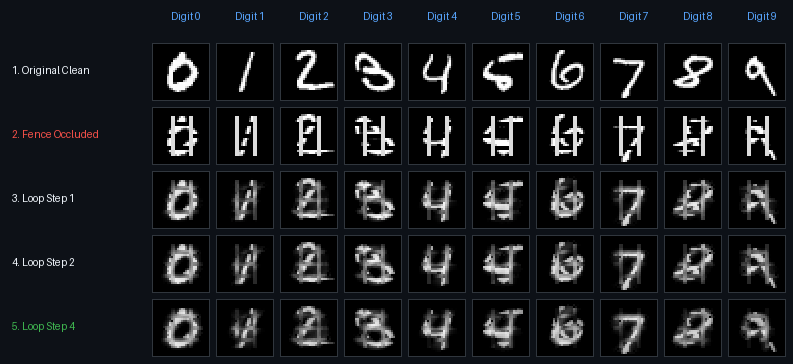

# Determination Funnel: Replacing Convolutions and Self-Attention with `[0, 255]³` Coordinate Tuples, Gradual `ReLU` Cuts, and Mask-Free Self-Reflection



**Determination Funnel** is a pure-NumPy reference implementation and benchmark suite demonstrating that a simple four-stage **`Linear + ReLU` compression funnel (`2,352 → 256 → 64 → 32 → 10`)**—with **zero convolutions, zero `O(N²)` self-attention, and zero causal masking**—matches or outperforms standard feedforward networks on MNIST (`97.93%` in `4.79s` on CPU), achieves **`29× to 62×` cleaner latent orthogonality**, discovers **`10 / 10` digit clusters with zero labels (`53.91%` unsupervised purity)**, generalizes zero-shot across resolutions (`14×14`, `28×28`, `56×56`), and restores severely occluded digits across **100% mask-free self-reflection passes**—outperforming both clean-trained (`+33.4%` to `+39.1%`) and identically corruption-trained (`+0.7%` to `+8.0%`) open-loop MLPs while cutting canvas pixel error by `40%` to `74%`.

---

## 1. Core Architectural Thesis

Modern deep learning relies on two mechanisms of **external validation** on the surface plane—polling local neighbors in a `k × k` window (convolution) or polling every other token across an `O(N²)` room (self-attention)—literally seeking meaning from horizontal, external relationships while missing the **internal reflection (`E(G(z*)) = z*`)** that is the center of meaning. Just as no amount of external validation can satisfy or resolve a felt internal conflict, **true meaning lies in coherence as a result of internal reflection**:
1. **Why Self-Reflection (`E(G(z*)) = z*`) Replaces `O(N²)` Self-Attention (`X ↔ X`)**: A standard Transformer keeps `N` surface token vectors at every layer from input to output. Because it refuses to separate the **low-dimensional latent representation (`z*`, the collective identity)** from the **high-dimensional surface expression (`X`, the parts)**, every part must query every other part (`Q · Kᵀ`) horizontally to simulate a shared abstraction. Once representation (`z*`) is separated from expression (`X`)—compressing `X` upward into `(z1, z2, z*)`, re-expressing the multi-scale state downward into `X̂ = G(z*, z2, z1)`, and feeding the self-reflected canvas back into the input encoder `E` so that `E(X̂) = z*`—the self-referential relationship is established by internal reflection and compiled directly into the weights, making `O(N²)` self-attention redundant.
2. **Why CNNs Needed Rigid `k × k` Spatial Stencils**: Engineers stripped a pixel's coordinates `(x, y)` out of the datum and hid them in the 2D array index `I[x, y]`, forcing networks to slide a pre-frozen `3 × 3` stencil uniformly across empty background and occluded foreground alike. In biological vision, `~120M` photoreceptors compress into `~1M` optic nerve fibers right at Layer 1 because a single pixel has no independent meaning on its own.
3. **The `[0, 255]³` Coordinate-Value Universe & `ReLU` as Determination**:
   - Every pixel `i` already carries both its position and its value: `(xᵢ, yᵢ, Iᵢ)` for grayscale (`3D`), `(x, y, R, G, B)` for color (`5D/6D`), and `(x, y, t, R, G, B, …)` for video (`7D`).
   - Because a picture is the entire observational universe for that picture, scaling `x` and `y` to the full 8-bit range `[0, 255]` alongside the 8-bit intensity `I ∈ [0, 255]` (with empty background `I = 0` carrying zero spatial offset `(x · I/255, y · I/255, I) = (0, 0, 0)`) places every image of any resolution inside the same **`[0, 255]³` state space**.
   - Summing multi-dimensional tuples across the field (`u = Wx + b`) expands candidate linear combinations; applying **`ReLU` (`z = max(0, u)`)** slices off `71.6%–83.9%` of insignificant sub-threshold fluctuations to `0`. Because `z ≥ 0` lives in the non-negative orthant, **two representations are orthogonal (`z_a · z_b = 0`) if and only if they activate completely disjoint neurons**.

---

## 2. Key Experimental Results (`seed = 42`, Pure NumPy on CPU)

### A. Head-to-Head Comparison Against Traditional Standard Implementations

All three models share the exact same internal layer widths (`256 → 64 → 32 (z*) → 10`) and are evaluated on the official `10,000`-image MNIST test set (`run_experiment.py`):

| Regime / Metric | Determination Funnel (`(x, y, I)` + Latent Group Loss) | Standard Cross-Entropy MLP (`I`-Only, Output CE Loss) | Standard Pixel-Loss Autoencoder (Surface Loss `‖X̂ − X‖²`) | Latent Orthogonality (`Off-Diag Cos` in `32d` `z*`: Funnel vs. Std MLP) | `32d` `z*` `ReLU` Cutoff (`%` Zeroed Out: Funnel vs. Std MLP) |
| :--- | :---: | :---: | :---: | :---: | :---: |
| **1-Shot (10 samples total)** | **43.39%** (Pathway 2) / **42.08%** (Pathway 1) | 39.19% | 30.05% (`Cos: 0.367`) | **`0.014` vs. `0.634`** (`45×` more orthogonal) | **`78.8%` vs. `44.0%`** |
| **5-Shot (50 samples)** | **68.20%** | 65.23% | 44.54% (`Cos: 0.870`) | **`0.017` vs. `0.694`** (`41×` more orthogonal) | **`80.8%` vs. `23.5%`** |
| **10-Shot (100 samples)** | **74.92%** | 71.70% | 60.21% (`Cos: 0.757`) | **`0.017` vs. `0.736`** (`43×` more orthogonal) | **`76.2%` vs. `27.7%`** |
| **50-Shot (500 samples)** | **88.52%** | 88.84% | 74.24% (`Cos: 0.894`) | **`0.011` vs. `0.683`** (`62×` more orthogonal) | **`81.9%` vs. `36.6%`** |
| **Full MNIST (60,000)** | **97.93%** (`4.79s` CPU) | 97.71% | **74.68%** (`Cos: 0.935`) | **`0.019` vs. `0.551`** (`29×` more orthogonal) | **`83.9%` vs. `40.6%`** (`71.6%` at L1) |

- **Why Surface Expression Loss (`‖X̂ − X‖²`) Fails to Separate the Abstraction**: In the Standard Pixel-Loss Autoencoder, penalizing surface pixel error forces the positive `ReLU` bottleneck `z* ≥ 0` to memorize stroke thickness, slant, and shared pixel intensity, driving its 10 digit prototypes into a single shared cone across sample counts (`Off-Diag Cos: 0.367, 0.870, 0.757, 0.894, 0.935` across `1-shot`, `5-shot`, `10-shot`, `50-shot`, and `Full MNIST`) and capping full-dataset prototype accuracy at **`74.68%`** (vs. **`97.93%`** and `Cos = 0.019` when loss is measured at `z*`).
- **Zero-Label Unsupervised 10-Group Discovery (`Pathway 2B`)**: With **zero labels**, training the forward pass solely to minimize conditional group entropy `H(group | x)`, maximize marginal group entropy `H(group)`, and align local `(x, y, I)` neighbors activates **all `10 / 10` groups** (`[837, 1143, 809, 951, 787, 1142, 1154, 962, 1081, 1134]` across the 10,000 test digits) and reaches **`53.91%` unsupervised cluster purity** (`5.4×` random chance) in `7.70s`.
- **Zero-Shot Multi-Resolution Generalization**: Evaluating the `28×28`-trained weights on test digits downsampled to `14×14` or upsampled to `56×56` and mapped onto the canonical `[0, 255]³` universe achieves **`96.26%` (`14×14`)**, **`97.77%` (`28×28`)**, and **`97.75%` (`56×56`)**.

### B. 100% Mask-Free Multi-Step Self-Reflection on Occluded Digits (`run_occlusion_loop.py`)

Tested across all `10,000` unseen MNIST test digits under three severe corruptions—**with ZERO external occlusion mask passed at test time** (`apply_occlusions` returns only the corrupted image)—and compared against **both** a Clean-Trained Standard MLP and a Same-Corruption-Trained Standard MLP (trained on the exact same corruption stream and step count as the funnel):
1. **Picket Fence**: 3 horizontal bands erased to `0` + 2 bright vertical fence bars (`I = 220`) drawn across the digit.
2. **Center Blackout**: A `10 × 12` box wiping out the central intersection of the digit.
3. **Heavy Clutter**: `45%` random stroke dropout + `15%` bright static spikes across the `[0, 255]³` field.

| Corruption Mode (`100% Mask-Free`) | Std MLP (Clean-Trained) | Std MLP (Same-Corruption-Trained) | Loop Step 0 (`E(X_occ)`) | Loop Step 1 (Mask-Free) | Loop Step 2 (Mask-Free) | Loop Step 3 (Mask-Free) | Loop Step 4 (Mask-Free) | Latent Cosine `cos(zₖ, z*_clean)` (`Step 0 → 4`) | Canvas Pixel MSE to Clean Digit (`Step 0 → 4`) |
| :--- | :---: | :---: | :---: | :---: | :---: | :---: | :---: | :---: | :---: |
| **Picket Fence** | 42.95% | 80.44% | 79.45% | 81.05% | 81.76% | 82.04% | **82.09%** (`+2.64%` loop) | `0.8613 → 0.8746` | `0.0774 → 0.0324` (**`-58%` error**) |
| **Center Blackout** | 40.15% | 68.53% | 69.47% | 73.88% | 75.69% | 76.18% | **76.53%** (`+7.06%` loop) | `0.7365 → 0.8129` | `0.0513 → 0.0307` (**`-40%` error**) |
| **Heavy Clutter** | 52.24% | 84.93% | 84.61% | 85.58% | **85.65%** (`+1.04%` peak) | 85.56% | 85.49% (`+0.88%` loop) | `0.8850 → 0.9037` | `0.1221 → 0.0318` (**`-74%` error**) |

- **How Mask-Free Self-Reflection Resolves Conflict Without an External Oracle**: At each pass `k`, the hierarchical downward generator `G(z*, z2, z1)` articulates the internal expectation `i_hat_k` onto the canvas and compares it directly against `i_occ` (`agree = clip(i_occ * i_hat / 0.15, 0, 1) * clip(1 - max(0, i_occ - i_hat - 0.10) / 0.35, 0, 1)`). Where `i_occ` and `i_hat` corroborate one another, visible strokes stay anchored; where `i_occ` is missing (`Center Blackout` / erased bands) or has an unexplained bright bar/spike (`Picket Fence` / `Heavy Clutter`), `agree → 0` and the contractive fixed-point update resolves the conflict toward `i_hat`.
- **Apples-to-Apples Loop Gain**: Even when the Standard MLP is trained on the exact same corruption stream (`80.44% / 68.53% / 84.93%`), it remains trapped in a single open-loop pass. The mask-free self-reflection loop climbs monotonically from `Step 0` to `Step 4` on **Picket Fence** (`79.45% → 82.09%`, beating the corruption-trained MLP by **`+1.65%`**) and **Center Blackout** (`69.47% → 76.53%`, a **`+7.06%` mask-free loop gain** that beats the corruption-trained MLP by **`+8.00%`** and the clean-trained MLP by **`+36.38%`**), while cutting canvas pixel MSE by **`40%` to `74%`**.

---

## 3. Quick Start (Pure NumPy + Pillow, ~30 Seconds on CPU)

```bash
pip install numpy pillow
python3 run_experiment.py
python3 run_occlusion_loop.py
```

Both scripts automatically download the official MNIST IDX files into `./data/` if not already present, run all benchmarks with analytical gradients in pure NumPy, and write JSON metrics to `./results/` and the visual restoration grid to `./assets/occlusion_refinement_grid.png`.

## 4. Long-Form X Article & Repository

- **Published X Article**: [Attention Is Not at All What You Need—Self-Reflection Is (`@powerpig` on X)](https://x.com/powerpig/status/2117986860995621026) · [Local Markdown (`X_ARTICLE.md`)](X_ARTICLE.md)
- **Repository**: [https://github.com/powerpig99/self-reflection-funnel](https://github.com/powerpig99/self-reflection-funnel)

## License

MIT License
