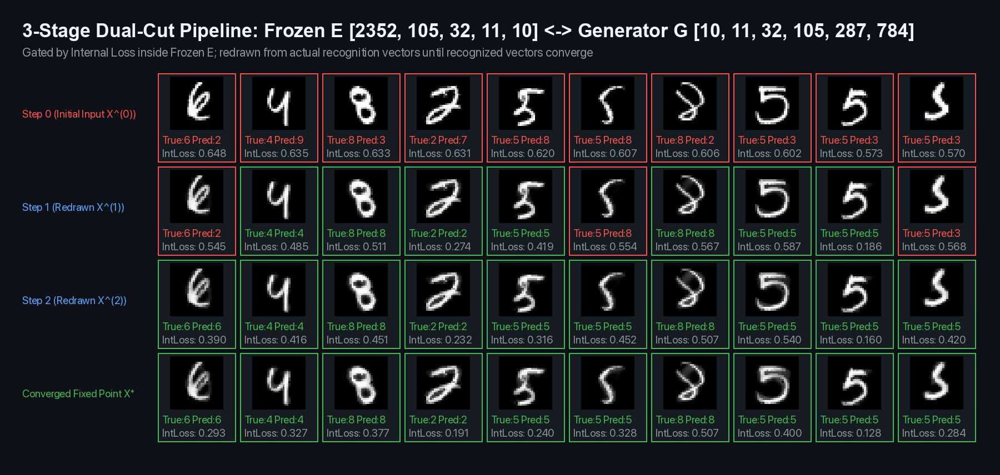

# Determination Funnel: Self-Reflection as the Dual Cut of Abstraction and Reverse-Diffusion Expression




**Determination Funnel** is a pure-NumPy reference implementation and benchmark suite grounded in [The Dual Cut](https://not-a-toe.com/posts/the-dual-cut/). It proposes that **self-attention is a special case of self-reflection**—extracting a low-dimensional abstraction from an input and applying that abstraction back onto the input's own high-dimensional payload:
- **Stage 1 (Gradual Supervised Recognition Discovery `E`, Starting from `d_in → 10`)**: Starting directly from `d_in → 10` (`L = 0`) with **zero preset power-of-two widths and zero artificial width floors (`min_width = 1`)** on held-out `train[:4000]`, splitting only the remaining gap `d*_{l-1} → 10` via $D_{\text{init}}(l) = \text{round}(\sqrt{d^*_{l-1} / 10} \cdot 10)$ and elastic breathing discovers:
  - **On `2,352` coupled `(x, y, I)` tuples (`2,352 → 10`)**: **`2,352 → 105 → 32 → 11 → 10`** (`250,940` parameters—**`59.6%` fewer parameters** than our earlier `621,226`-parameter `2,352 → 256 → 64 → 32 → 10` funnel, reaching **`97.67%` head accuracy**, **`97.58%` prototype accuracy**, and **`0.0191` off-diagonal cosine**). At `L = 2`, the second cut contracts from `35 → 12`; at `L = 3`, the third cut is initialized at $\text{round}(\sqrt{12 / 10} \cdot 10) = 11$, expands to `13`, and returns to `11`, terminating discovery at the fixed point $\text{round}(\sqrt{11 / 10} \cdot 10) = 10$.
  - **On `784` pixel-order intensities (`784 → 10`, where vector slot order already encodes `(x_i, y_i)` in a dense layer)**: **`784 → 85 → 30 → 10 → 10`** (**`69,725` parameters**, `97.42%` head / `97.33%` prototype accuracy, `0.0171` off-diagonal cosine), where the third cut initializes at `14` and contracts by 4 units (`14 → 11 → 10`), landing directly on the exact class count `10`.
- **Stage 2 (Reverse-Diffusion Generator `G` Trained by Iterative Redraw Against Frozen `E`)**: Because expression (`G: Z → X̂`) requires expanding detail across the large gap (`105 → 784` or `85 → 784`), inserting the midpoint layer $d_{\text{mid}} = \text{round}(\sqrt{784 / d_1} \cdot d_1)$ (`287` for `d_1 = 105`; `258` for `d_1 = 85`) creates a uniform `~2.8×` reverse-diffusion cascade. `G` is trained on clean numbers by feeding **frozen `E`'s actual recognition vectors** $Z^{(k)} = E(X^{(k)})$ into `G` to redraw $X^{(k+1)}$, re-recognizing $X^{(k+1)}$ with frozen `E`, and measuring supervised loss against the desired label `y`.
- **Stage 3 (Reality-Anchored vs. Single-Variable Unconstrained Relaxation of `E` and `G`)**:
  - **Single-Variable Reality-Anchor Ablation**: Keeping every learning rate, clean-digit update, corrupted-input update, and loss weight 100% identical to Stage 3 Anchored and removing *only* the `correct_0` gate (so `E` updates on all redrawn $X^{(1)}$ unconditionally) isolates Judge Drift: without `correct_0`, the **hardest 5% tail drops `-2.60%` at Step 0** (`71.20% → 68.60%`) and **`-3.20%` (Self-Judged 3B: `69.60% → 66.40%`) / `-1.60%` (Frozen-Judged 3A: `70.00% → 68.40%`) converged**, **Picket Fence drops `-1.81%` (3B: `75.78% → 73.97%`) / `-1.46%` (3A: `75.84% → 74.38%`)**, and the self-judged loop churns for **`11.63` steps instead of `8.76` steps** on the hardest 5% digits.
  - **True 1-to-1 Same-Size & Closest-Size Baseline Comparisons (22 Epochs Same Corruption Stream)**:
    - **At `86,300` parameters (`784 → 105 → 32 → 11 → 10`)**: The pure pixel-order `784`-Funnel (`86,300` params) beats the exact same-size `86,300`-parameter Standard MLP (`97.51%` Natural, `64.60%` Fence, `65.42%` Blackout, `83.30%` Clutter) by **`+0.37%` on Natural MNIST** (`97.88%` Step 0 / `97.83%` converged), **`+8.64%` on Picket Fence** (`73.24%`), and **`+3.74%` on Heavy Clutter** (`87.04%`), while jumping **`+2.55%` at Step 0 on Center Blackout** (`61.77% → 62.98%`) over the `2,352`-tuple funnel.
    - **At `~220k–251k` parameters**: Our headline `2,352`-Tuple Funnel **Stage 3A** (`250,940` params) ties the closest-in-size **`219,818`-parameter Standard MLP** (`784 → 256 → 64 → 32 → 10`, `98.03%` Natural) on Natural MNIST (`98.00%` Step 0 / `97.94%` converged), leads by **`+3.94%` on Picket Fence** (`75.84%` vs. `71.90%`) and **`+1.98%` on Heavy Clutter** (`87.72%` vs. `85.74%`), and trails on Center Blackout (`61.75%` vs. `66.38%`).
- **Stage 4 (Test-Time Diffusion Gated by Internal Loss & The Human in the Loop)**: At test time (with zero retraining), gating by `E`'s intrinsic **Internal Loss (`L_internal`)** means `95%` of natural digits take almost no loop steps (`0.00` mean steps in 3B, `0.16` in 3A), while uncertain inputs iterate the mask-free redraw loop until `L_internal` stops dropping and the recognized vectors converge (`‖z^{(k+1)} - z^{(k)}‖_2 ≤ ε`). Persistent residual `L_internal` on genuine cross-class hybrids provides the exact signal for when to defer the final judgment call to the human in the loop.

## 1. Documented 4-Stage Implementation Plan & Architectural Thesis

Full architectural specification: [IMPLEMENTATION_PLAN.md](IMPLEMENTATION_PLAN.md).

1. **Why Fixed-Task Perception Needs Zero `O(N²)` Token Polling—and When Pixel Order Already Encodes Position**:
   - Under [The Dual Cut](https://not-a-toe.com/posts/the-dual-cut/), every token in an open-ended sequence carries both substantive payload (`V`) and operational instruction (`K`). In fixed-task visual recognition, however, the top-level command—*"recognize this picture as one of the 10 digits `0–9`"*—is **implied by the problem statement itself** (`d_out = 10`) and compiled into the network.
   - In a dense linear cut $u = \sum_{i=1}^{784} I_i w_i + b$, each pixel slot $i \in \{0, \dots, 783\}$ has its **own dedicated weight row** $w_i \in \mathbb{R}^{d_1}$, which means the vector index $i$ already binds each intensity $I_i$ to its spatial coordinate $(x_i, y_i)$: $x_i I_i w_{i,x} + y_i I_i w_{i,y} + I_i w_{i,I} = I_i(x_i w_{i,x} + y_i w_{i,y} + w_{i,I})$. Explicit `[0, 255]³` `(x, y, I)` coordinate tuples are needed when rescaling across variable resolutions (`14×14`, `28×28`, `56×56` in `run_experiment.py`), whereas on a fixed `28×28` grid, feeding the `784` ordered intensities directly eliminates the `3×` Layer-1 parameter expansion (`250,940 → 86,300` or `69,725` parameters) and removes the `(x·I, y·I)` coordinate-norm distortion under Center Blackout.
2. **Why Abstraction (`E`) and Expression (`G`) Are Asymmetric—and Why Co-Adaptation Needs a Reality Anchor**:
   - **Abstraction (`E`)** is many-to-one lossy compression: `ReLU` cuts zero out `67.6%–85.7%` of sub-threshold fluctuations across the three hidden cuts, isolating `10` orthogonal digit cones (`Off-Diag Cos = 0.0171–0.0191`).
   - **Expression (`G`)** is one-to-many detail synthesis: it bridges the `d_1 → 784` chasm via the midpoint layer `d_mid = round(sqrt(784 / d_1) * d_1)` and acts as an intermediate diffusion denoiser.
   - **Judge Drift & The Human in the Loop**: In our single-variable **Stage 3 Unconstrained** ablation (`run_diffusion_reflection.py`), removing only the `correct_0` gate so `E` trains unconditionally to predict `y` on every redrawn canvas $X^{(1)}$ causes `E` to bend its boundaries around `G`'s wrong-class hallucinations—dropping the hardest 5% natural tail by `-2.60%` at Step 0 (`71.20% → 68.60%`) and `-3.20%` converged (`69.60% → 66.40%` self-judged), dropping Picket Fence by `-1.81%` (`75.78% → 73.97%` in 3B) / `-1.46%` (`75.84% → 74.38%` in 3A), and forcing `11.63` loop steps instead of `8.76` on hard digits.

## 2. Experimental Results (`seed = 42`, Pure NumPy on CPU)

### A. Stage 1 — Gradual Layer & Width Discovery (`run_elastic_funnel.py`)

Starting directly from `d_in → 10` (`L = 0`) with `min_width = 1` (zero artificial floor) on held-out `train[:4000]` for width selection, each refinement step `l` splits the remaining gap between the **actual discovered width `d*_{l-1}`** and `10` at $D_{\text{init}}(l) = \text{round}(\sqrt{d^*_{l-1} / 10} \cdot 10)$:

| Input Representation & Step (`L`) | Midpoint Init (from Discovered `d*_{l-1}`) | Discovered Architecture (`[d_in, …, 10]`) | Parameters (`%` Shed vs. Init) | Test Accuracy (`Head / Proto`) | Mean Internal Loss (`L_internal`) | Latent Orthogonality (`Off-Diag Cos`) | Next Midpoint $\text{round}(\sqrt{d^*_l/10}\cdot 10)$ |
| :--- | :--- | :--- | :---: | :---: | :---: | :---: | :---: |
| **`2,352`-Tuple `L = 0`** | `[2352, 10]` | **`[2352, 10]`** | `23,530` (`0.0%`) | `92.59% / 92.59%` | `0.1492` | `0.2231` | `153` |
| **`2,352`-Tuple `L = 1`** | `[2352, 153, 10]` | **`[2352, 121, 10]`** | `285,933` (`-20.9%`) | `97.56% / 92.81%` | `0.1402` | `0.1433` | `35` |
| **`2,352`-Tuple `L = 2`** | `[2352, 153, 35, 10]` | **`[2352, 121, 12, 10]`** | `286,307` (`-21.7%`) | `97.41% / 97.34%` | `0.0747` | `0.0253` | `11` |
| **`2,352`-Tuple `L = 3` (Fixed Pt)** | `[2352, 153, 35, 11, 10]` | **`[2352, 105, 32, 11, 10]`** | **`250,940` (`-31.4%`)** | **`97.67% / 97.58%`** | **`0.0595`** | **`0.0191`** | **`10` (Converged!)** |
| **`784` Pixel-Order `L = 0`** | `[784, 10]` | **`[784, 10]`** | `7,850` (`0.0%`) | `92.54% / 92.54%` | `0.1559` | `0.1951` | `89` |
| **`784` Pixel-Order `L = 1`** | `[784, 89, 10]` | **`[784, 76, 10]`** | `60,430` (`-14.6%`) | `97.64% / 92.89%` | `0.1387` | `0.1407` | `28` |
| **`784` Pixel-Order `L = 2`** | `[784, 89, 28, 10]` | **`[784, 84, 21, 10]`** | `67,945` (`-6.5%`) | `97.50% / 97.36%` | `0.0786` | `0.0371` | `14` |
| **`784` Pixel-Order `L = 3` (Fixed Pt)** | `[784, 89, 28, 14, 10]` | **`[784, 85, 30, 10, 10]`** | **`69,725` (`-4.4%`)** | **`97.42% / 97.33%`** | **`0.0601`** | **`0.0171`** | **`10` (`14→10` Converged!)** |

### B. Stages 2–4 — `784` & `2,352` Funnels vs. Same-Size MLP Baselines & Single-Variable Anchor Ablation (`run_diffusion_reflection.py`)

All values below come directly from `results/diffusion_reflection_results.json`. All Standard MLP baselines are trained on the **exact same corruption stream (`forward_diffusion_on_clean`) for the same 22 epochs of exposure** (`12` clean epochs + `10` clean & diffusion epochs on `train[4000:]`):

| Model / Pipeline Stage (`10,000` Unseen Test Set) | Parameters (`E`) | Natural MNIST (`All 10k`) | Natural MNIST (`Hardest 5% Tail`) | Picket Fence (`Step 0 → Converged`) | Center Blackout (`Step 0 → Converged`) | Heavy Clutter (`Step 0 → Converged`) |
| :--- | :---: | :---: | :---: | :---: | :---: | :---: |
| **1. Same-Size `69.7k` Standard MLP (`784 → 85 → 30 → 10 → 10`, 22 ep)** | `69,725` | `97.55%` | — | `74.27%` | `59.74%` | `82.92%` |
| **2. Discovered `69.7k` `784`-Funnel (`784 → 85 → 30 → 10 → 10`, Stage 3A)** | `69,725` | **`97.68%` → `97.64%`** | `65.80% → 65.00%` (`8.8` steps) | `73.05% → 73.38%` (`+0.33%`, `3.3` steps) | `60.23% →` **`61.22%`** (`+0.99%`, `4.7` steps) | `85.98% →` **`86.45%`** (`+0.47%`, `3.2` steps) |
| **3. Same-Size `86.3k` Standard MLP (`784 → 105 → 32 → 11 → 10`, 22 ep)** | `86,300` | `97.51%` | — | `64.60%` | **`65.42%`** | `83.30%` |
| **4. Same-Size `86.3k` `784`-Funnel (`784 → 105 → 32 → 11 → 10`, Stage 3A)** | `86,300` | **`97.88%` → `97.83%`** | `69.60% → 68.60%` (`7.9` steps) | `71.98% →` **`73.24%`** (`+1.26%`, `3.9` steps) | `61.77% →` **`62.98%`** (`+1.21%`, `4.5` steps) | `86.31% →` **`87.04%`** (`+0.73%`, `3.1` steps) |
| **5. Closest-to-`251k` Standard MLP (`784 → 256 → 64 → 32 → 10`, 22 ep)** | `219,818` | **`98.03%`** | — | `71.90%` | **`66.38%`** | `85.74%` |
| **6. Stage 2 (`Frozen E + Trained G`, `2352 → 105 → 32 → 11 → 10`)** | `250,940` | `97.36% → 97.40%` | `63.80% → 64.60%` (`10.3` steps) | `74.11% → 75.69%` (`+1.58%`, `3.7` steps) | `55.91% → 59.20%` (`+3.29%`, `4.8` steps) | `83.90% → 85.26%` (`+1.36%`, `3.4` steps) |
| **7. Stage 3B Unconstrained (1-Var No-Anchor, Self-Judged)** | `250,940` | `97.91% → 97.80%` | `68.60% → 66.40%` (`11.6` steps) | `73.22% → 73.97%` (`+0.75%`, `4.6` steps) | `60.16% → 63.61%` (`+3.45%`, `5.3` steps) | `86.99% → 87.63%` (`+0.64%`, `3.9` steps) |
| **8. Stage 3A Unconstrained (1-Var No-Anchor, Judged by `E_frozen`)** | `250,940` | `97.91% → 97.90%` | `68.60% → 68.40%` (`5.8` steps) | `73.22% → 74.38%` (`+1.16%`, `3.3` steps) | `60.16% → 62.87%` (`+2.71%`, `3.8` steps) | `86.99% → 87.76%` (`+0.77%`, `2.8` steps) |
| **9. Stage 3B Reality-Anchored (`Relaxed E + G`, Self-Judged)** | `250,940` | **`98.00%` → `97.92%`** | **`71.20%` → `69.60%`** (`8.8` steps) | `74.23% → 75.78%` (`+1.55%`, `3.5` steps) | `59.22% →` **`62.40%`** (`+3.18%`, `4.6` steps) | `87.07% → 87.67%` (`+0.60%`, `2.9` steps) |
| **10. Stage 3A Reality-Anchored (`Relaxed E + G`, Judged by `E_frozen`)** | `250,940` | **`98.00%` → `97.94%`** | **`71.20%` → `70.00%`** (`6.3` steps) | `74.23% →` **`75.84%`** (`+1.61%`, `3.4` steps) | `59.22% → 61.75%` (`+2.53%`, `4.2` steps) | `87.07% →` **`87.72%`** (`+0.65%`, `2.9` steps) |

### C. Reference Benchmark Comparisons (`run_experiment.py` & `run_occlusion_loop.py` — Used in Companion Videos)

The companion films in `./video/` present our original `2,352 → 256 → 64 → 32 → 10` (`621,226` parameters with biases; `620,864` weights-only) reference benchmarks from `run_experiment.py` (`results/results.json`, 12 clean epochs) and `run_occlusion_loop.py` (`results/occlusion_results.json`, 12 corruption-matched epochs with original-canvas stroke anchoring):

| Regime / Metric (`run_experiment.py`, 12 Clean Epochs) | Determination Funnel (`256→64→32`, `(x, y, I)` + Latent Group Loss) | Standard Cross-Entropy MLP (`256→64→32`, `I`-Only, Output CE) | Standard Pixel-Loss Autoencoder (Surface Loss `‖X̂ − X‖²`) | Latent Orthogonality (`Off-Diag Cos`: Funnel vs. Std MLP) | `z*` `ReLU` Cutoff (`%` Zeroed Out: Funnel vs. Std MLP) |
| :--- | :---: | :---: | :---: | :---: | :---: |
| **1-Shot (10 samples total)** | **43.39%** (Fwd) / **42.08%** (Loop) | 39.19% | 30.05% (`Cos: 0.367`) | **`0.014` vs. `0.634`** (`45×` more orthogonal) | **`78.8%` vs. `44.0%`** |
| **5-Shot (50 samples)** | **68.20%** | 65.23% | 44.54% (`Cos: 0.870`) | **`0.017` vs. `0.694`** (`41×` more orthogonal) | **`80.8%` vs. `23.5%`** |
| **10-Shot (100 samples)** | **74.92%** | 71.70% | 60.21% (`Cos: 0.757`) | **`0.017` vs. `0.736`** (`43×` more orthogonal) | **`76.2%` vs. `27.7%`** |
| **50-Shot (500 samples)** | **88.52%** | 88.84% | 74.24% (`Cos: 0.894`) | **`0.011` vs. `0.683`** (`62×` more orthogonal) | **`81.9%` vs. `36.6%`** |
| **Full MNIST (60,000, 12 Clean Ep)** | **97.93%** (Head) / **97.77%** (Proto) | 97.71% | **74.68%** (`Cos: 0.935`) | **`0.019` vs. `0.551`** (`29×` more orthogonal) | **`83.9%` vs. `40.6%`** (`71.6%` at L1) |

And on the 4-step corruption-matched mask-free loop in `run_occlusion_loop.py` (`results/occlusion_results.json`):
- **Picket Fence**: Clean MLP `42.95%` | Same-Corruption MLP `80.44%` | Funnel Loop `79.45%` (Step 0) → **`82.09%`** (Step 4, `+2.64%` loop gain, `-58%` pixel MSE).
- **Center Blackout**: Clean MLP `40.15%` | Same-Corruption MLP `68.53%` | Funnel Loop `69.47%` (Step 0) → **`76.53%`** (Step 4, `+7.06%` loop gain, `-40%` pixel MSE).
- **Heavy Clutter**: Clean MLP `52.24%` | Same-Corruption MLP `84.93%` | Funnel Loop `84.61%` (Step 0) → **`85.65%`** (Step 2) / **`85.49%`** (Step 4, `-74%` pixel MSE).

## 3. Quick Start (Pure NumPy + Pillow on CPU)

```bash
pip install numpy pillow
python3 run_elastic_funnel.py         # Stage 1: Gradual layer & width discovery (2352 -> 10 and 784 -> 10)
python3 run_diffusion_reflection.py   # Stages 1-4: 2352 & 784 Funnels + 1-Var Anchor Ablation + Same-Size Baselines
python3 run_experiment.py             # Reference 256->64->32 few-shot, unsupervised, and multi-resolution benchmarks
python3 run_occlusion_loop.py         # Reference 256->64->32 4-step corruption-matched occlusion benchmark
python3 render_tables.py              # Render Retina PNG benchmark tables directly from ./results/*.json
```

## License

MIT License
